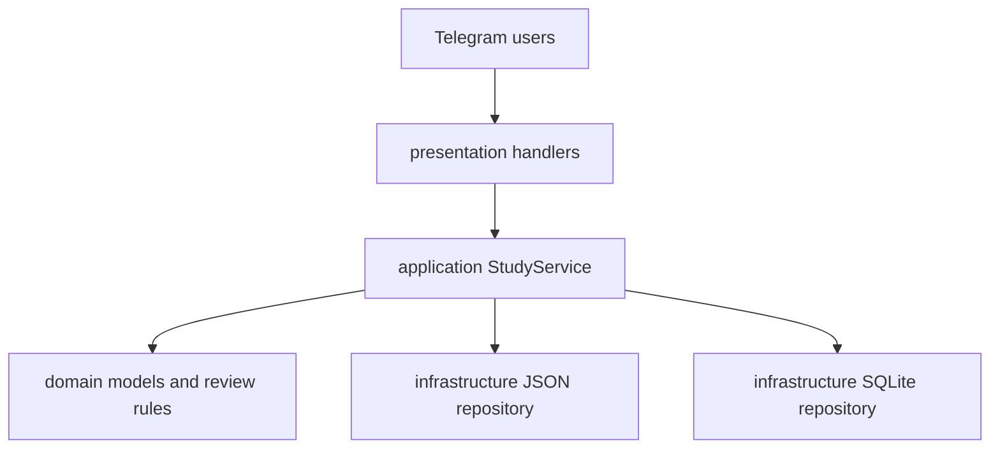

# Architecture

Quantum Tutor uses a small layered architecture with dependencies pointing inward.

## Layers

- `src/quantum_tutor/domain/`: framework-independent learning records and spaced-repetition rules.
- `src/quantum_tutor/application/`: use cases that select questions, record grades, and report progress.
- `src/quantum_tutor/infrastructure/`: JSON curriculum and SQLite adapters.
- `src/quantum_tutor/presentation/`: Telegram commands and callback-button interactions.
- `src/quantum_tutor/main.py`: composition root; constructs dependencies and starts polling.
- `curriculum/`: attributed, editable learning content. Empty chapters intentionally establish the schema without inventing course material.

## Design decisions

1. Curriculum content stays outside Python so it can be reviewed independently and expanded without deployments that alter logic.
2. The application service does not import Telegram, making learning behavior testable without network access.
3. SQLite is accessed through a repository, allowing a later PostgreSQL adapter without changing handlers.
4. Review scheduling is deterministic and isolated in the domain layer.
5. Telegram `user_data` holds only the currently displayed question; durable grades and review state live in SQLite.

## Adding content

Add terms and formulas to the relevant `curriculum/chapter_NN.json`. IDs must be stable and unique because progress records refer to them. Do not label authored material as official, and replace the general source placeholder with a verified course URL when available.
