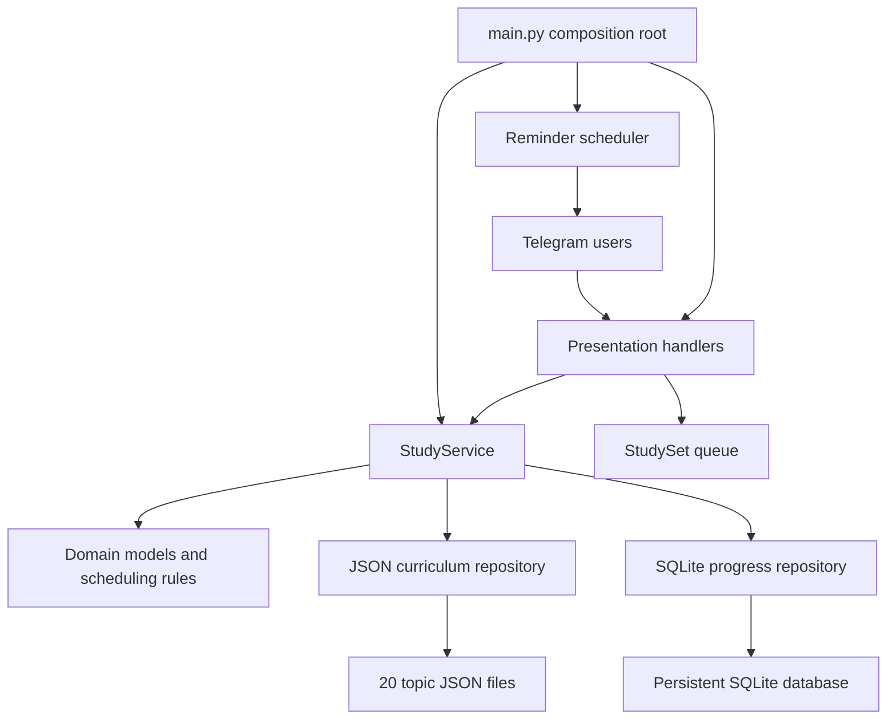
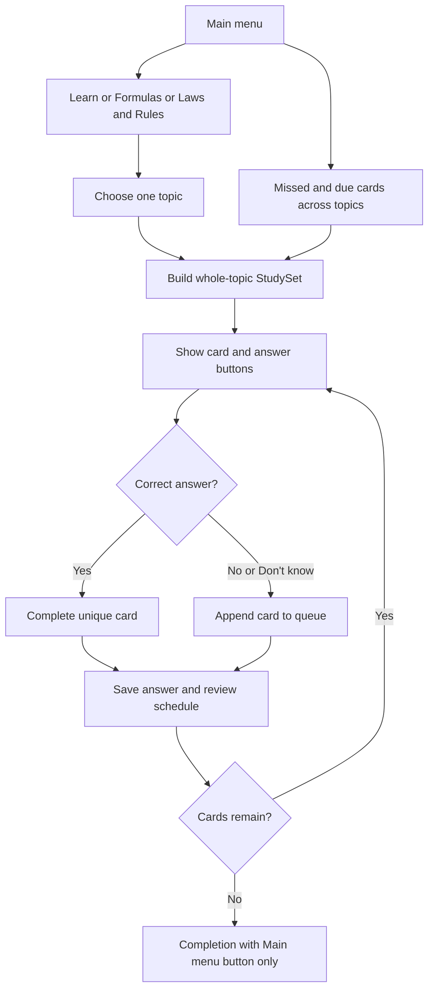

# Architecture

Quantum Tutor is a single-process Telegram bot with a JSON curriculum and SQLite learning history. It runs by long polling in one Docker container on an always-on server. No web frontend or external AI service is required.

## Repository layout

```text
QuantumMechanics-FU/
├── src/quantum_tutor/
│   ├── main.py                  Application composition and command registration
│   ├── config.py                Environment configuration and user allowlist
│   ├── scheduler.py             Daily timezone-aware reminder jobs
│   ├── presentation/
│   │   └── handlers.py          Commands, topic keyboards, and study interactions
│   ├── application/
│   │   └── study.py             Card catalog, modes, choices, grading, review lookup
│   ├── domain/
│   │   ├── models.py            Chapters, sections, concepts, formulas, review state
│   │   ├── study_set.py         Queue, retries, and session completion
│   │   └── spaced_repetition.py Deterministic review scheduling
│   └── infrastructure/
│       ├── curriculum.py       Active topic JSON loader
│       └── database.py         SQLite queries and additive schema migration
├── curriculum/
│   ├── topic_01.json … topic_20.json  The only active curriculum catalog
│   ├── script_contents.tsv           Supplied 109-section source index
│   └── imported/                     Staged, inactive formula-image workbook
│       ├── import_workbook.py        Extractor for that image workbook
│       ├── formulas.json             72 source records, not active exercises
│       └── images/                   Original equation images
├── tests/                            Domain, content, navigation, and persistence tests
├── data/                             Local SQLite data and backups; not source code
├── README.md                         User, setup, and deployment guide
├── CONTENT_AUDIT.md                   Corrections, source warnings, audit limitations
├── ARCHITECTURE.md                   This document
├── pyproject.toml                    Package, dependencies, entry point, test configuration
├── Dockerfile                        Runtime image
└── compose.yaml                      Single bot service and persistent data volume
```

Python package `__init__.py` files are intentionally retained. They define package boundaries even when their only content is a docstring. Virtual environments, caches, logs, secrets, and databases are local runtime artifacts, not files to commit.

## Responsibilities and dependencies



The domain does not import Telegram or SQLite. `StudyService` is framework-independent but directly uses the concrete repository adapters; this is a small layered application, not a dependency-injection framework. `main.py` constructs the adapters and service. Handlers currently orchestrate per-user sessions; the scheduler reuses the main keyboard so reminders cannot drift from normal navigation.

## One curriculum source

Only `curriculum/topic_*.json` is loaded. The duplicate legacy `chapter_*.json` catalog and obsolete `experiments.json` index have been removed; do not recreate them as a second source of truth.

- The shared navigation button is labeled **Chapters & Experiments**. Theory entries show `Chapter` plus their number and original title; experimental entries show `Experiment` plus title and supplied date. `/topics` and old delivered labels remain compatible. These are display names; active filenames and IDs are unchanged.
- Theory IDs **1–10** retain the original chapter numbering.
- Experimental IDs **11–20** represent the ten experimental topic buttons.
- Stable card IDs, not row positions or display names, connect content to progress.
- The current catalog contains **543 concept cards + 12 standalone formulas = 555 cards**. Counts change when material is imported.
- `StudyService.cards()` adapts standalone formulas into the same concept-card shape used by the queue, retaining their original IDs.
- Section outlines remain source/reference metadata and support old subsection button messages; normal navigation starts whole-topic sets.

The TSV source index is retained as an independent test fixture for supplied headings and page references. The staged image workbook is also retained because it contains distinct source records and images; it is not a duplicate active catalog.

## Learning lifecycle



Modes share one exercise-generation and grading path:

- **Learn:** all concept and standalone formula cards in the selected topic.
- **Formulas:** the topic's equation-bearing cards; equations can be in either the key-rule or definition field depending on the workbook.
- **Laws & Rules:** all topic cards, with verbal prompts focused on meanings/applications.
- Whenever an equation exists, answer buttons show the readable equation in every mode; verbal cards use statement choices.
- Questions expose only answer choices, Don't know, and Main menu. There is no legacy reveal/Hard/Okay/Easy interaction in normal navigation.
- Correct answers advance; incorrect answers requeue. A single unfinished card repeats immediately. Main menu exits at any point.
- Completion percentages refer to unique cards in the current set, not exam readiness or durable mastery.

Distractors are unique, prefer related material, and exclude identical names, known overlapping concepts, and obvious near-duplicates. These heuristics do not constitute symbolic equivalence checking or a guarantee that every possible distractor is false; see `CONTENT_AUDIT.md`.

## Session state versus durable history

Telegram `context.user_data` holds each user's active mode, selected topic, `StudySet`, current question, answer-label mapping, and timing information. This state is in memory and resets when the process restarts.

SQLite stores:

- `answers`: attempt history, correctness, rating, response time, scheduler version, and timestamp.
- `reviews`: one current scheduled state per `(user_id, item_id)`, including repetitions, interval, and due time.

A correct multiple-choice answer maps to the internal Okay rating; an incorrect answer or Don't know maps to Repeat. Repeat schedules ten minutes later; Okay advances through the established day intervals. Historical Hard/Easy scheduling support remains for compatibility, not as current UI buttons.

Review selects **currently missed cards immediately**, plus cards whose due time has arrived. It resolves saved IDs against the active catalog and skips retired or unknown IDs without deleting their history. Corrected review answers move the card to a future date; it returns when due.

Topic percentages use the current account's successfully recorded card states. All accounts are isolated by Telegram user ID. The schema migration adds missing answer metadata columns without deleting history or rewriting existing due dates.

## Formula and source metadata

Topic JSON retains original workbook references, raw LaTeX, BOX priorities, source caveats, correction history, and pending source checks. Raw LaTeX is metadata: Telegram buttons accept plain text, not HTML, LaTeX rendering, or equation images. No math-image renderer or Mini App is implemented.

Original author/source claims are not automatically official FU requirements. Supplied experimental dates are explicitly distinguished from independently verified schedules. Unresolved mathematical conventions display source-check warnings in feedback.

## Operation and safety

- Exactly **one poller per Telegram token**. Do not run the laptop copy while the server instance is active.
- `compose.yaml` uses `restart: unless-stopped` and mounts the named data volume at `/app/data`.
- Set `DATABASE_PATH=data/quantum_tutor.db` so progress survives container replacement.
- Configuration and tokens remain in `.env`; never include it in source archives or Git.
- Back up SQLite consistently before deployments and migrations. Do not delete the data volume during source cleanup.
- Source cleanup must not erase progress databases, backups, or staged source material simply because the running bot does not load it.

## Validation

Run `pytest` and `python -m compileall -q src` from the repository root in the project virtual environment. Tests cover imported card counts and references, unique answer choices, formula-button grading, mode/topic navigation, retry queues, completion controls, private access, source-index consistency, review persistence, and deterministic scheduling.
